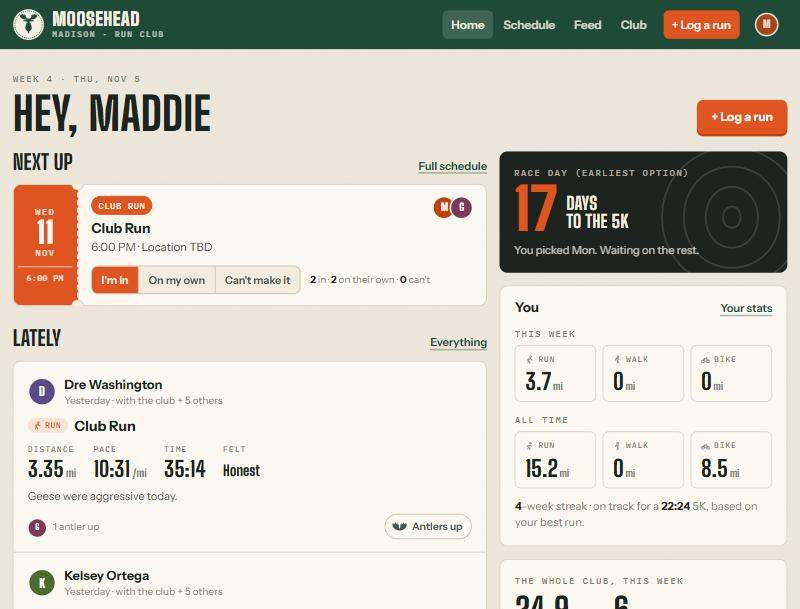
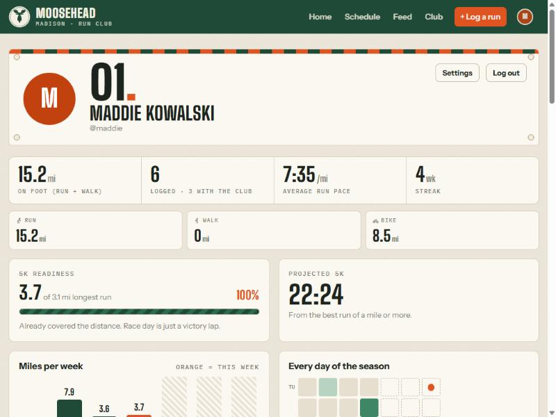
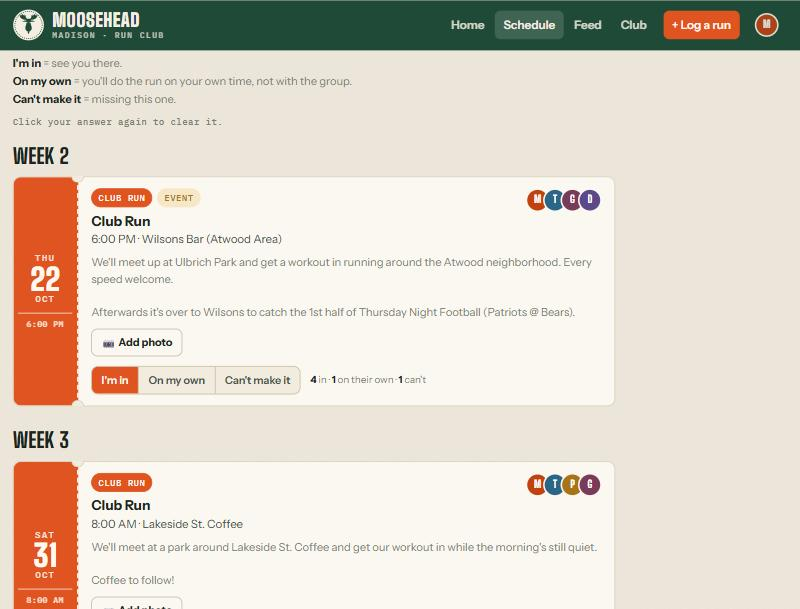
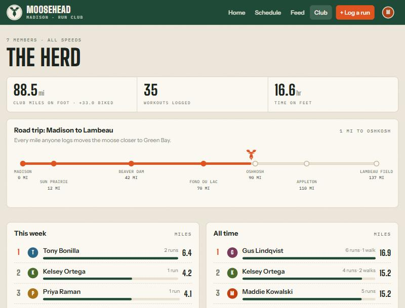
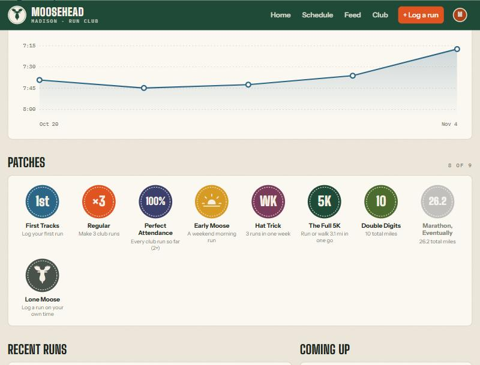
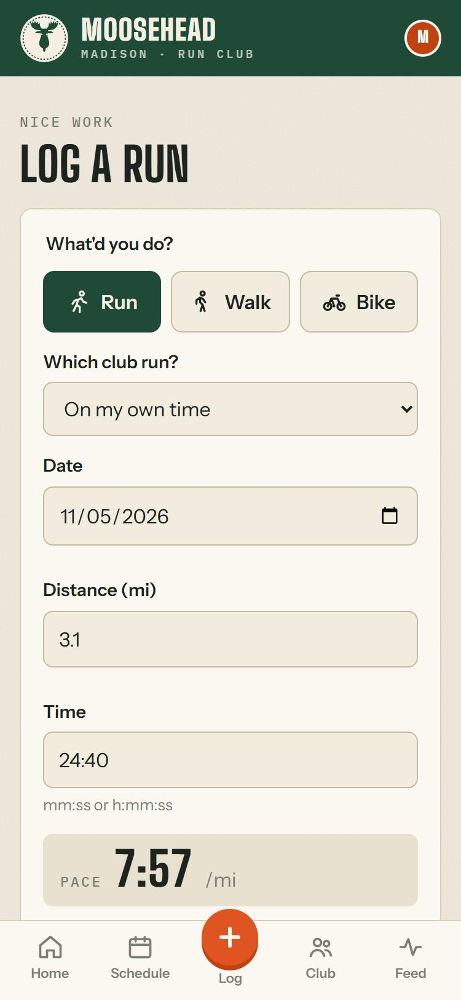

# Madison Moosehead Run Club

**Live: [moosehead.up.railway.app](https://moosehead.up.railway.app)** (members only; joining takes a club code)

A website for a casual run club of friends training together for a 5K: weekly club runs with
RSVPs, a Strava-style run, walk and bike log with a feed, personal stats, photos from each run, and a
vote on race day. Built for under 10 people of every ability, from "never run" to "runs every day".

<table>
  <tr>
    <td width="50%"></td>
    <td width="50%"></td>
  </tr>
  <tr>
    <td></td>
    <td></td>
  </tr>
  <tr>
    <td></td>
    <td align="center"></td>
  </tr>
</table>

<sub>Screenshots use made-up demo members and runs.</sub>

## Design decisions

- **One meetup a week, everything else optional.** Friends said three a week was too many, so
  there's one club run a week and people log whatever else they do on their own time.
- **Run, walk or bike.** Every log is one of the three. Leaderboards and the road trip count miles
  on foot (run + walk); pace stats use runs only; rides show speed in mph instead of pace.
- **Photos from every run.** Anyone can add photos to a club run from its day on; they show as a
  gallery on the run's page.
- **Privacy by default**: email and phone are only visible to the admin; photos and profile pictures
  are re-encoded to strip location data; signup needs a club code and is rate-limited.
- **No front-end framework**: server-rendered pages, one hand-written stylesheet, and charts drawn
  as plain SVG. Fast on phones, no build step.
- **Character over templates**: meetups look like ticket stubs, profiles like race bibs, badges
  like sewn-on patches, and the club's combined miles drive a moose down the road to Lambeau Field.

I first built optional 6-week training plans with a signup quiz, then removed them when few
people used them. Keeping the site small mattered more than keeping a feature.

Built by John Oliver with [Claude Code](https://claude.com/claude-code) as a coding partner: I
designed the features, schedule, training approach and look; Claude wrote most of the code.

## What's in it

| Page | What it does |
|---|---|
| `/signup` | Join with the club code. Full name + username (public), email + optional phone (only the admin sees those). Any password. |
| `/welcome` | One optional step after signup: add a profile picture. |
| `/` | The next club run (with RSVP and photo buttons), race countdown, your week by Run / Walk / Bike, recent activity. |
| `/schedule` | One club run a week, then the 5K. **I'm in** / **On my own** (doing it on your own time) / **Can't make it**. |
| `/meetups/{id}` | Who's coming, map link, description, and the photo gallery for that run. |
| `/log` | Log a run: distance, time, which meetup (or on your own), how it felt, notes. |
| `/feed` | Everyone's runs. "Antlers up" = kudos. |
| `/u/{username}` | Profile: race-bib header, totals, 5K readiness, projected 5K, miles per week, daily heatmap, pace chart, patches (badges). |
| `/club` | Club totals, leaderboards (week + all time), the road trip to Lambeau, turnout per meetup, members. |
| `/race` | Vote: Sun Nov 22 / Mon Nov 23 / Tue Nov 24. |
| `/admin` | Members with emails and phone numbers; reset passwords; **Logs** (switch any log between Run / Walk / Bike); quick-edit each run's date, time, place and description; lock the race date. |

## Tech stack (same shape as the other projects)

- **Python + FastAPI**, server-rendered **Jinja2** templates. No JS framework, no build step.
- **One hand-written stylesheet**: `app/static/club.css`. All colors are tokens at the top;
  dark mode swaps them. Fonts: Big Shoulders Display, Instrument Sans, IBM Plex Mono.
- **Charts are plain SVG/CSS**, with the math in `app/stats.py` and the drawing in `app/templates/_viz.html`.
- **SQLAlchemy**: SQLite locally (`local.db`), Postgres on Railway. `DATABASE_URL` decides.
- **Profile pictures live in the database** (resized to 400px, location metadata stripped),
  because Railway's disk is wiped on each deploy.
- **uv** for Python and dependencies.

## Running it locally

```bash
uv sync
uv run python -m uvicorn app.main:app --port 8002
```

Open http://localhost:8002. `.env` already has a `SESSION_SECRET`, the club code (`moose`) and an
admin login for **john** with a generated password. To set your own password:

```bash
uv run python scripts/create_user.py john
```

### Demo data

`local.db` currently has six pretend members (Maddie, T-Bone, Priya, Gus, Kelsey, Dre; password
`moosetracks`) with runs through Nov 5, so you can see the stats filled in. To view the site "as of"
that date, set `CLUB_TODAY`:

```bash
CLUB_TODAY=2026-11-05 uv run python -m uvicorn app.main:app --port 8002
```

Remove the pretend members with `uv run python scripts/demo_data.py --wipe` (or just delete `local.db`).
The demo script refuses to run when `DATABASE_URL` is set, so it can't touch Postgres.

### Tests

```bash
uv run python -m pytest
```

## Editing things by hand

The site re-reads these files on every page load:

| File | What's in it |
|---|---|
| `config/club.yaml` | Club name, start date (Oct 13, 2026), the three race-day options, **the starting list of club runs**, the road-trip stops |

The schedule is created from the `meetups:` list (Oct 22, Oct 31, Nov 4, Nov 11, Nov 19) the first
time the app starts with no meetups. After that, change things on the site: the **Schedule** section of
the Admin page edits date / time / place inline, and "More" (or "Edit date, time, place" on any run)
has the title, details, event tag and cancel. **+ Add a meetup** for extras like "Run + Thursday Night
Football". Canceled runs keep their history but get struck out.

## Deploying to Railway

1. Push this folder to a GitHub repo.
2. In Railway: **New Project > Deploy from GitHub repo**. It builds from the `Dockerfile`.
3. Add a **Postgres** database to the project.
4. On the web service, set variables:
   - `DATABASE_URL` = `${{Postgres.DATABASE_URL}}`
   - `SESSION_SECRET` = a long random string
   - `ADMIN_USERNAME` = `john`, `ADMIN_PASSWORD` = your password (only used to create the login the first time)
   - `CLUB_CODE` = whatever you'll share in the group chat
   - `HTTPS_ONLY_COOKIES` = `1`
   - **Don't** set `CLUB_TODAY` in production.
5. **Settings > Networking > Generate Domain**, then share the link and the club code.

The live service is connected to this repo, so every push to `main` deploys automatically.

The first boot creates the tables, your admin login and the schedule. Adding a column to a model
later is handled automatically on startup (see `app/db.py`).

Forgotten passwords: Admin page > **Reset password** shows a one-time temporary password to send them.
