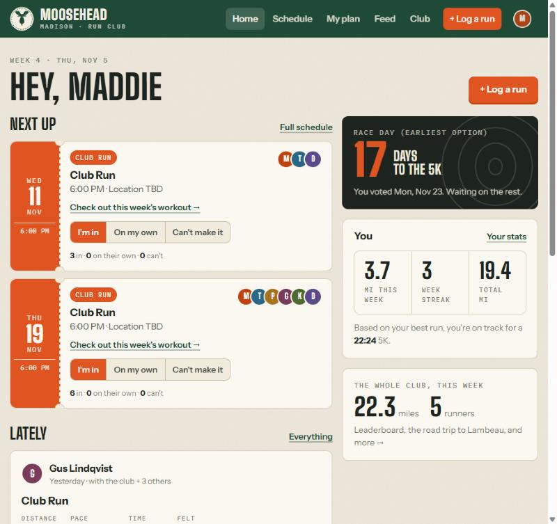
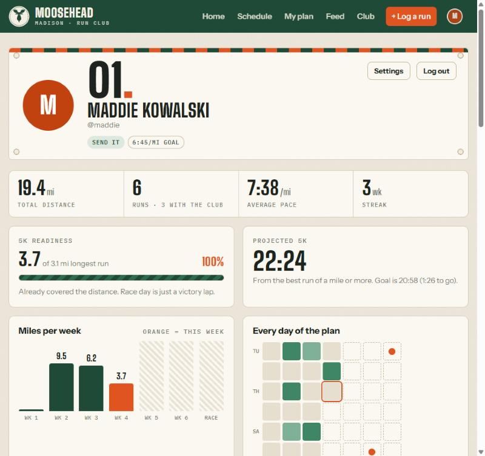
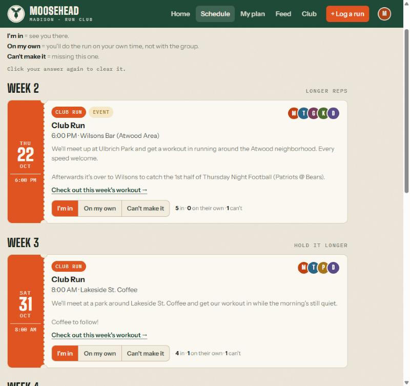
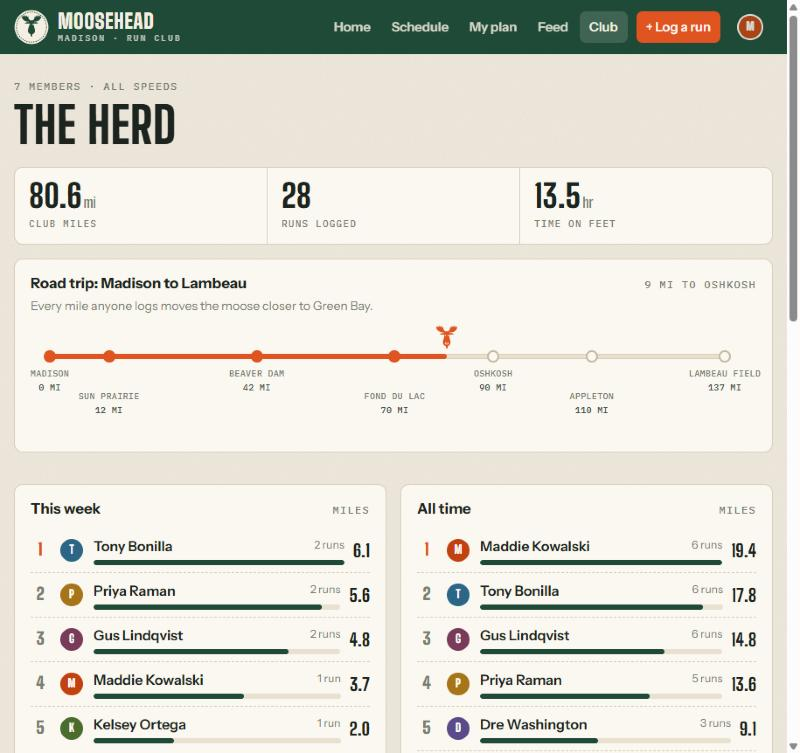
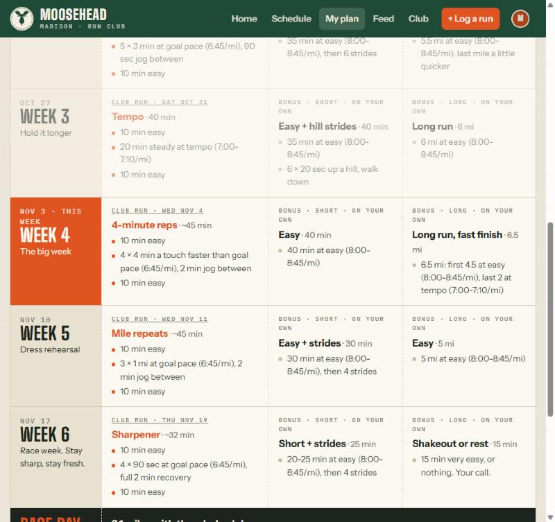
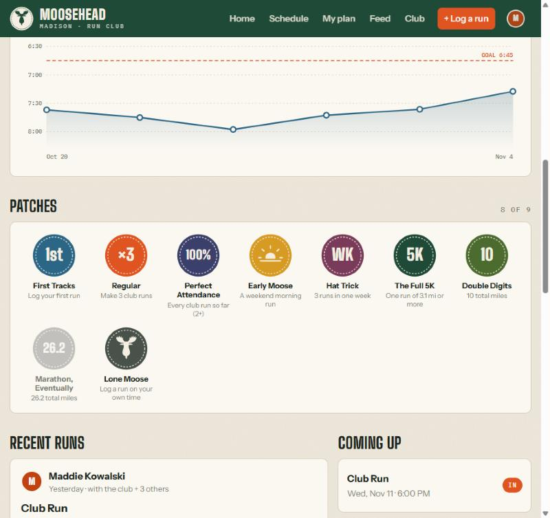
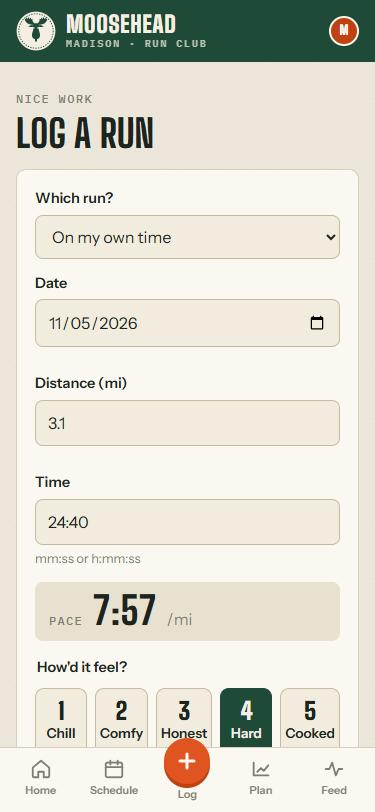

# Madison Moosehead Run Club

**Live: [moosehead.up.railway.app](https://moosehead.up.railway.app)** (members only; joining takes a club code)

A website for a casual run club of friends training together for a 5K: weekly club runs with
RSVPs, a Strava-style run log and feed, personal stats, optional training plans, and a vote on
race day. Built for under 10 people of every ability, from "never run" to "runs every day".

<table>
  <tr>
    <td width="50%"></td>
    <td width="50%"></td>
  </tr>
  <tr>
    <td></td>
    <td></td>
  </tr>
  <tr>
    <td></td>
    <td></td>
  </tr>
</table>

<p align="center"></p>

<sub>Screenshots use made-up demo members and runs.</sub>

## Design decisions

- **One meetup a week, everything else optional.** Friends said three a week was too many. Each
  week has one club run; plans add two optional solo runs around it.
- **Plans are opt-in.** At signup you choose "give me a plan" (3-question quiz, then a suggested
  goal pace and one of five plans) or "I'll do my own thing". You can switch either way later.
- **Workouts are time-based**, e.g. "5 × 3 min at goal pace", so a 6:30/mi runner and a
  run/walker can share the same loop and finish around the same time.
- **The quiz math is simple and explainable**: mile-time guess → 5K pace via Riegel's formula,
  adjusted for recent distance and frequency, rounded to 15 seconds.
- **Privacy by default**: email and phone are only visible to the admin; profile photos are
  re-encoded to strip location data; signup needs a club code and is rate-limited.
- **No front-end framework**: server-rendered pages, one hand-written stylesheet, and charts drawn
  as plain SVG. Fast on phones, no build step.
- **Character over templates**: meetups look like ticket stubs, profiles like race bibs, badges
  like sewn-on patches, and the club's combined miles drive a moose down the road to Lambeau Field.

Built by John Oliver with [Claude Code](https://claude.com/claude-code) as a coding partner: I
designed the features, schedule, training approach and look; Claude wrote most of the code.

## What's in it

| Page | What it does |
|---|---|
| `/signup` | Join with the club code. Full name + username (public), email + optional phone (only the admin sees those). Any password. |
| `/welcome` | "Give me a plan" or "I'll do my own thing". Plan: 3-question quiz -> suggested goal (accept it, pick one of the 5 plans, or type a pace) -> profile picture. Own: straight to the profile picture. |
| `/` | Next club runs with RSVP buttons and a link to that week's workout, race countdown, your week, recent club runs. |
| `/schedule` | One club run a week, then the 5K. **I'm in** / **On my own** (doing it on your own time) / **Can't make it**. |
| `/meetups/{id}` | Who's coming, map link, and each plan's club workout for that week. |
| `/log` | Log a run: distance, time, which meetup (or on your own), how it felt, notes. |
| `/feed` | Everyone's runs. "Antlers up" = kudos. |
| `/u/{username}` | Profile: race-bib header, totals, 5K readiness, projected 5K, miles per week, daily heatmap, pace chart, patches (badges). |
| `/club` | Club totals, leaderboards (week + all time), the road trip to Lambeau, turnout per meetup, members. |
| `/plan` | Your 6-week plan with your paces filled in, each week's club run linked to its meetup. Browse the other plans, change your goal, switch plans, or stop following one. Own-workout folks see the plans as ideas. |
| `/race` | Vote: Sun Nov 22 / Mon Nov 23 / Tue Nov 24. |
| `/admin` | Members with emails, phone numbers, training choice and quiz answers; reset passwords; **quick-edit each run's date, time and place**; add/cancel meetups; lock the race date. |

## Tech stack (same shape as the other projects)

- **Python + FastAPI**, server-rendered **Jinja2** templates. No JS framework, no build step.
- **One hand-written stylesheet**: `app/static/club.css`. All colors are tokens at the top;
  dark mode swaps them. Fonts: Big Shoulders Display, Instrument Sans, IBM Plex Mono.
- **Charts are plain SVG/CSS**, with the math in `app/stats.py` and the drawing in `app/templates/_viz.html`.
- **SQLAlchemy**: SQLite locally (`local.db`), Postgres on Railway. `DATABASE_URL` decides.
- **Profile pictures live in the database** (resized to 400px, location metadata stripped),
  because Railway's disk is wiped on each deploy.
- **uv** for Python and dependencies.

## Running it locally

```bash
uv sync
uv run python -m uvicorn app.main:app --port 8002
```

Open http://localhost:8002. `.env` already has a `SESSION_SECRET`, the club code (`moose`) and an
admin login for **john** with a generated password. To set your own password:

```bash
uv run python scripts/create_user.py john
```

### Demo data

`local.db` currently has six pretend members (Maddie, T-Bone, Priya, Gus, Kelsey, Dre; password
`moosetracks`) with runs through Nov 5, so you can see the stats filled in. To view the site "as of"
that date, set `CLUB_TODAY`:

```bash
CLUB_TODAY=2026-11-05 uv run python -m uvicorn app.main:app --port 8002
```

Remove the pretend members with `uv run python scripts/demo_data.py --wipe` (or just delete `local.db`).
The demo script refuses to run when `DATABASE_URL` is set, so it can't touch Postgres.

### Tests

```bash
uv run python -m pytest
```

## Editing things by hand

The site re-reads these files on every page load:

| File | What's in it |
|---|---|
| `config/club.yaml` | Club name, plan start date (Oct 13, 2026), the three race-day options, **the starting list of club runs**, the road-trip stops |
| `config/plans.yaml` | The five training plans, week by week. Pace placeholders `{goal}` `{tempo}` `{easy}` get filled in per runner. Separate the parts of a workout with ` · ` and each part shows on its own line. |

The schedule is created from the `meetups:` list (Oct 22, Oct 31, Nov 4, Nov 11, Nov 19) the first
time the app starts with no meetups. After that, change things on the site: the **Schedule** section of
the Admin page edits date / time / place inline, and "More" (or "Edit date, time, place" on any run)
has the title, details, event tag and cancel. **+ Add a meetup** for extras like "Run + Thursday Night
Football". Canceled runs keep their history but get struck out.

## The plans

| Plan | Goal pace | Who it's for |
|---|---|---|
| Send It | up to 7:00/mi (built around 6:30) | Already running a few times a week, wants to race |
| Push It | 7:00-8:15/mi (built around 7:30) | Runs sometimes, wants a real time |
| Chase It | 8:15-10:00/mi (built around 9:00) | Can run a mile or two, wants to run the whole thing |
| Cruise It | 10:00-12:00/mi (built around 11:00) | New to running, wants to jog the whole 5K: jog/walk at first, 20+ min nonstop by week 5 |
| Finish It | slower, or no time goal | Starting from zero: run/walk all the way, walk breaks on race day are fine |

How they're built:

- **Plans are optional.** At signup people choose a recommended plan or their own workouts, and can
  switch either way later on the Plan page.
- **The weekly club run carries the plan.** Each week has one club workout (done together at that
  week's meetup) plus two optional bonus runs on your own. The club column alone is a complete
  progression. Week 1 (Oct 13-19) has no meetup, so that club workout is done solo.
- **Club workouts are time-based** (e.g. "5 × 3 min at goal pace") so a mixed group can share a
  loop and finish around the same time. The meetup page shows what every plan is running that week.
- Weeks 1-2 introduce goal pace in short reps, 3-4 stretch it (tempo, longer reps), week 5 is a dress
  rehearsal, week 6 is race week (short and sharp, fresh legs).
- Skipped a week? Repeat the last week done instead of jumping ahead (the plan page says so).

**The quiz:** mile time -> 5K pace with Riegel's formula (about 7% slower than mile pace), plus time if
your longest recent run is short or you rarely run, rounded to 15 seconds. Slower than 12:00/mi
suggests the Finish It plan. Logic and answer options are in `app/quiz.py`.

## Deploying to Railway

1. Push this folder to a GitHub repo.
2. In Railway: **New Project > Deploy from GitHub repo**. It builds from the `Dockerfile`.
3. Add a **Postgres** database to the project.
4. On the web service, set variables:
   - `DATABASE_URL` = `${{Postgres.DATABASE_URL}}`
   - `SESSION_SECRET` = a long random string
   - `ADMIN_USERNAME` = `john`, `ADMIN_PASSWORD` = your password (only used to create the login the first time)
   - `CLUB_CODE` = whatever you'll share in the group chat
   - `HTTPS_ONLY_COOKIES` = `1`
   - **Don't** set `CLUB_TODAY` in production.
5. **Settings > Networking > Generate Domain**, then share the link and the club code.

The first boot creates the tables, your admin login and the schedule. Adding a column to a model
later is handled automatically on startup (see `app/db.py`).

Forgotten passwords: Admin page > **Reset password** shows a one-time temporary password to send them.
